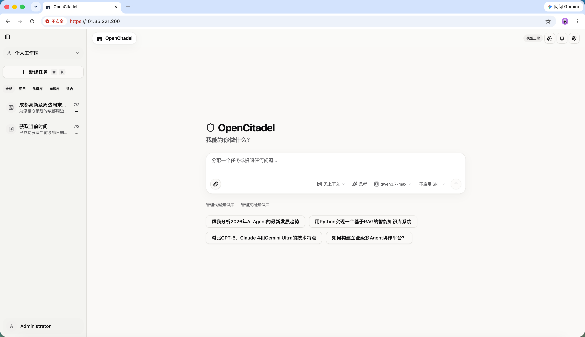
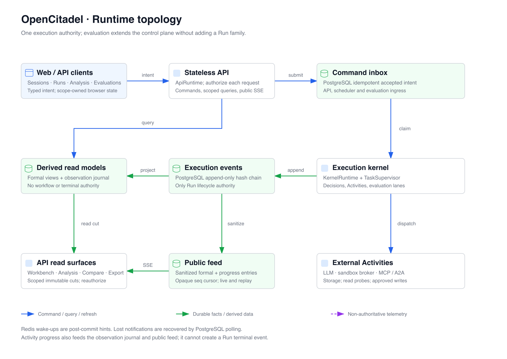

# OpenCitadel — Self-Hosted Enterprise AI Agent Platform

<div align="center">

**Private deployment · Every tool call declarable, approvable, traceable, and provable · MCP / A2A · Sandboxed execution**

[](LICENSE)
[](https://www.python.org/)
[](https://fastapi.tiangolo.com/)
[](https://nextjs.org/)
[](https://docs.docker.com/compose/)

[简体中文](README.zh-CN.md) · [Documentation](docs/README.md) · [GitHub](https://github.com/OceaLong/opencitadel)

</div>

---

OpenCitadel is a **governed, self-hosted AI agent platform**. Keep data, model calls, and file storage on your network; agents run browser, shell, and file tools inside isolated sandboxes and reach internal systems via MCP and A2A. Governance is part of the execution protocol: **every external call has a declared effect, durable invocation identity, policy snapshot, optional approval, and verifiable audit evidence**.

Most agent-governance offerings are point solutions; OpenCitadel is an integrated platform:

| Capability        | MCP gateways     | Agent firewalls / guardrails     | Read-only diagnostics (k8sgpt, etc.) | OpenCitadel                                                 |
| ----------------- | ---------------- | -------------------------------- | ------------------------------------ | ----------------------------------------------------------- |
| Coverage          | MCP traffic only | Single policy-interception point | Read-only, no execution              | Browser / shell / file / MCP / A2A — the full tool chain    |
| Human-in-the-loop | —                | Approval point                   | —                                    | Persisted per-invocation approval + VNC takeover            |
| Evidence          | Access logs      | Logs                             | —                                    | API-layer hash-chained audit + verifiable evidence packages |
| Deployment        | Gateway          | Sidecar/SDK                      | CLI                                  | Full self-hosted platform (Compose / Helm)                  |

> Web Operator targets **enterprise-owned/self-hosted systems**; third-party SaaS requires an ownership declaration and audit trail—not a waiver of legal risk.

## Demo video

Due to the large size of the video file, please click on the image or link below to watch the complete demonstration:

[](https://www.bilibili.com/video/BV1QGNi6BERh/?vd_source=4ce3545913066879813a27e759a60c52)

> Video link: [Click here to watch the complete demonstration](https://www.bilibili.com/video/BV1QGNi6BERh/?vd_source=4ce3545913066879813a27e759a60c52)

## Core modules

| Module                       | Route                         | Description                                                                                                                                     |
| ---------------------------- | ----------------------------- | ----------------------------------------------------------------------------------------------------------------------------------------------- |
| **Agent chat**               | `/`, `/sessions/[id]`         | Event-sourced Agent/Ask Runs, per-invocation approval, VNC takeover, durable replay                                                             |
| **Ops Patrol**               | `/patrols`                    | Read-only infrastructure checks with approval-gated remediation: closed-world collector, server-side assertion engine, signed evidence packages |
| **Execution workbench**      | `/runs`, `/runs/[id]`         | Scoped Run projections, pinned playback, detail bodies, approval decisions and exports                                                          |
| **Analysis**                 | `/analysis`                   | Captured evidence sources, comparisons and artifact diffs                                                                                       |
| **Evaluations**              | `/evaluations`                | Cases, Subject/Judge batches, scoring and environment lifecycle                                                                                 |
| **Automation**               | `/automation`                 | Scheduled jobs, webhooks, notifications                                                                                                         |
| **Governed context sources** | `/knowledge`                  | Document knowledge bases: versioning, atomic publish, session version binding, retrieval Q&A                                                    |
| **Integrations**             | Settings modal → Integrations | MCP (stdio / SSE / streamable HTTP) and A2A remote agents                                                                                       |
| **Admin**                    | `/admin/*`                    | Users, quotas, audit, usage, compliance evidence                                                                                                |

## Quick start

**BYO API key setup**

```bash
git clone https://github.com/OceaLong/opencitadel.git
cd opencitadel
make quickstart
```

Open **http://localhost:8088**, sign in, configure an inference **endpoint**,
**model**, and **chat binding** in Settings → Inference, and run your first
agent task.

New installations use text extraction and keyword search for knowledge bases.
Vector search, reranking, GraphRAG, and OCR can be enabled after configuring
their models; existing policies are preserved on upgrade.

`make quickstart` also builds the sandbox image and defaults to local MinIO storage — see the guides below for cloud storage and full configuration.
The first build downloads browser and system dependencies; its duration depends
on the network and image caches. Subsequent starts reuse the built images.

- Step-by-step: [Self-hosting tutorial](docs/tutorials/01-self-host-10-minutes.md)
- Production: [Deployment guide](docs/operations/deployment.md)
- HTTPS & domain: [HTTPS setup](docs/operations/https-domain-setup.md)

## Architecture at a glance



- **Single execution authority**: PostgreSQL events drive every Run; Redis is only a recoverable wake-up hint
- **Explicit composition**: independent typed `ApiRuntime` / `KernelRuntime` graphs own resources, supervised tasks, and bounded shutdown
- **Identity-safe client data**: authenticated caches are scoped by `userId + workspaceId` and invalidated before identity changes
- **Sandbox isolation**: on-demand Docker or Kubernetes sandboxes with browser automation and VNC
- **Governed write plane**: `ops-collector` (8090) is read-only; `ops-actuator` (8091) accepts exactly three registered write actions, reachable only after human approval — see [Governance plane](docs/architecture/governance-plane.md)
- **Deployment**: Docker Compose (single node) or Helm / Kubernetes (horizontal scale)

Full design: [Architecture overview](docs/architecture/overview.md).

The execution workbench, analysis, comparisons, and exports read pinned evidence cuts. Evaluation Subject/Judge Runs reuse the same kernel. See [Execution analysis](docs/architecture/execution-analysis.md) and [Evaluation control plane](docs/architecture/evaluation-control-plane.md).

## Documentation map

| Audience             | Start here                                                                                                                                                                                                                                                                                                        |
| -------------------- | ----------------------------------------------------------------------------------------------------------------------------------------------------------------------------------------------------------------------------------------------------------------------------------------------------------------- |
| First run            | [Self-hosting tutorial](docs/tutorials/01-self-host-10-minutes.md) · [10-minute governance demo loop](docs/tutorials/08-ten-minute-governance-demo.md)                                                                                                                                                            |
| Ops / DevOps         | [Deployment](docs/operations/deployment.md) · [Ops Patrol](docs/tutorials/06-ops-patrol.md) · [Approved remediation](docs/tutorials/07-approved-remediation.md) · [Patrol operations](docs/operations/ops-patrol.md) · [HTTPS](docs/operations/https-domain-setup.md) · [Helm](deploy/helm/opencitadel/README.md) |
| Enterprise use cases | [Internal knowledge base](docs/tutorials/02-internal-knowledge-base.md) · [MCP integrations](docs/tutorials/03-mcp-integrations.md) · [Governed Web Operator](docs/tutorials/04-governed-web-operator.md) · [Refund reconciliation & compliance](docs/tutorials/05-refund-reconciliation-compliance.md)           |
| Platform engineers   | [Docs index](docs/README.md) · [Execution kernel](docs/architecture/execution-kernel.md) · [Security model](docs/architecture/security-model.md) · [Ops Patrol architecture](docs/architecture/ops-patrol.md)                                                                                                     |
| Contributors         | [Contributing](.github/CONTRIBUTING.md) · [Security](.github/SECURITY.md)                                                                                                                                                                                                                                         |

## Repository layout

| Directory                         | Responsibility                                                                                          |
| --------------------------------- | ------------------------------------------------------------------------------------------------------- |
| `api/`                            | API and execution kernel; domain, application, adapters, composition and tests                          |
| `ui/`                             | Next.js application and frontend tests                                                                  |
| `sandbox/`                        | Isolated browser, shell and VNC runtime                                                                 |
| `ops-collector/`, `ops-actuator/` | Independently deployed read and approved-write services                                                 |
| `deploy/`                         | Nginx, Helm, Kustomize and operator configuration                                                       |
| `demo/`                           | OpsConsole example and disposable Patrol fixture lab                                                    |
| `e2e/`                            | Browser acceptance scenarios, providers and evidence collectors                                         |
| `scripts/`                        | Bootstrap, backup, acceptance orchestration and capacity tooling; tests live in `tests/` subdirectories |
| `contracts/`                      | Shared acceptance and i18n schemas                                                                      |
| `docs/`                           | Maintained architecture, operations and tutorials                                                       |

Keep service-specific code and tests with their service. Put deployment assets in
`deploy/` and runnable examples in `demo/`. Retired plans remain in Git history;
generated files belong in ignored output directories such as `tmp/`.

## Local development

```bash
make quickstart
# First startup prints the generated admin login; configure inference after login

# Or run API / UI tests separately
cd api && uv sync --all-groups && uv run pytest --ignore=tests/app/integration/test_execution_visualization_closed_loop.py
cd ui && npm ci && npm run test
```

API integration tests require the configured PostgreSQL database; strict mode also requires its supporting services. See the module guide for Docker setup.
The excluded six current-invocation consumers run in the [acceptance runner](e2e/README.md), after their native evidence is produced and validated; all six must pass without skips.

Module guides: [api/README.md](api/README.md) · [ui/README.md](ui/README.md) · [sandbox/README.md](sandbox/README.md)

Configuration starts with six optional choices in `.env.example`; credentials
are generated once and saved in private `.env`. `make configure` prepares it
without starting containers. Advanced overrides are grouped in
[`deploy/config/.env.reference`](deploy/config/.env.reference).

## License

Licensed under the [Apache License 2.0](LICENSE).
