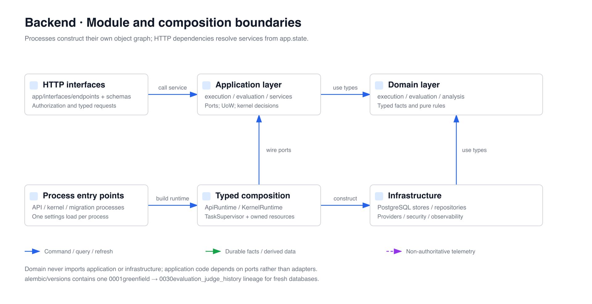

# OpenCitadel API and Execution Kernel

[简体中文](README.zh-CN.md)

The Python backend has three explicit process roles. PostgreSQL execution
events are the only workflow authority; Redis is a disposable wake-up channel.

| Role             | Entrypoint                                          | Responsibility                                                                                                |
| ---------------- | --------------------------------------------------- | ------------------------------------------------------------------------------------------------------------- |
| API              | `app.main` / `run.sh`                               | Authentication, authorization, command admission, projection queries, SSE                                     |
| Execution kernel | `app.execution_kernel_main` / `execution-kernel.sh` | Inbox, decisions, Activities, timers, outbox, projectors, scheduler, evaluation and comparison/export workers |
| Migrate          | `app.migrate` / `migrate.sh`                        | Greenfield Alembic schema and typed Runtime Policy seed                                                       |

The API never runs Agent or ingestion workflow steps. The execution kernel
polls durable PostgreSQL work and may also wait on Redis hints. Deleting Redis
cannot delete an accepted command, Activity, timer, event, or outcome.

Migration seeds text extraction and keyword search for knowledge bases on a new
database. Vector search, reranking, GraphRAG, and OCR start disabled; optional
models and Execution Policy fields enable them later. Existing policy heads,
revisions, and Run snapshots remain unchanged on upgrade. See
[knowledge ingestion](../docs/architecture/knowledge-base-ingestion.md).

## Technology

- Python 3.12, FastAPI, Pydantic 2
- SQLAlchemy 2 async, Alembic, PostgreSQL 16, pgvector
- Redis 7 for wake-up hints and cache only
- OpenAI, Anthropic, and Gemini model adapters
- MCP, A2A, Playwright, Docker/Kubernetes sandboxes
- OpenTelemetry and Prometheus

## Source map



All nondeterministic provider work is an Activity. An invocation identity,
input digest, timeout, policy snapshot, and call-start state are committed
before the external call. Completion returns through a typed command. Formal
Run, Activity, approval, resource-build, and public-event tables are
rebuildable projections, not alternate state machines.

## Composition and transactions

`app.main:create_app --factory` loads deployment settings once and installs a
lifespan-owned `ApiRuntime` on `app.state`. `app.execution_kernel_main` builds a
separate `KernelRuntime`. `TaskSupervisor` owns every background coroutine and
performs bounded drain; the roles do not share resource instances.

Application mutations call `uow.commit()` explicitly. Context exit without a
commit always rolls back, including a normal return. Repository methods never
commit, and Redis publication is a post-commit hint after PostgreSQL succeeds.

Use `/api/health/live` for process liveness and `/api/health/ready` for complete
runtime readiness. `/api/status` is a dependency diagnostic, not a lifecycle
probe.

## Security boundaries

Authenticated requests resolve an immutable `AuthorizationContext` and
`OwnerScope`. Transaction-local PostgreSQL settings drive forced RLS. The
greenfield deployment provisions separate application, execution-kernel, and
migration roles; schema ownership is not granted to runtime roles.

- User resources are personal or belong to one team workspace.
- Auditors are read-only.
- Administrators manage global resources and platform configuration.
- Cross-scope lookups fail closed and normally return not found.
- LLM and integration secrets use only versioned `fernet_v2` envelopes.

## Core HTTP contract

All application routes are under `/api`.

- `/auth/*`, `/teams/*`, `/service-keys/*`: identity and workspaces
- `/sessions/*`: session CRUD, message command admission, public event replay,
  VNC and files; `?q=` title/message search, and the soft-delete recycle bin
  (`GET /sessions/deleted`, `POST /sessions/{id}/delete|restore|purge`)
- `/execution-runs/*`, `/execution-artifacts/*`, `/execution-sources/*`: workbench, pinned `at`, bounded Step/Timeline/Body pages, events and SSE
- `/execution-analysis/*`, `/execution-comparisons/*`: captured analysis, timezone preferences, comparison revisions, diff jobs and private CSV/JSON exports
- `/evaluation/*`: datasets, configuration/rubric/suite, preflight and batches, recorded/isolated environments, scores/reviews and protected archival
- `/runs/*`, `/approval-batches/*`: formal execution and approval commands
- `/approvals`: reviewer inbox — `GET /approvals?status=pending` (also
  `approved`/`rejected`/`cancelled`/`expired`) across Runs
- `/knowledge-bases/*`: immutable candidate builds and published version
  bindings, plus the soft-delete recycle bin (`GET /knowledge-bases/deleted`,
  `DELETE /knowledge-bases/{id}`, `POST /{id}/restore`,
  `DELETE /{id}/purge`)
- `/scheduled-jobs/*`, `/patrol-*`: automation, patrol, evidence, remediation;
  `GET /scheduled-jobs/{id}/runs` returns paginated firing history
- `/artifacts/*`: workspace artifacts with desensitized share fields
  (`is_shared`, `share_expires_at`, `share_token_preview`); the full share token
  is returned only once on create/rotate
- `/a2a` (inbound, `X-Api-Key`): A2A JSON-RPC — `message/send`,
  `message/stream`, `tasks/get`, `tasks/cancel`
- `/capabilities`: platform capability report including `report_pdf`
- `/inference/endpoints/*`, `/inference/models/*`, `/inference/bindings/*`,
  `/skills/*`, `/runtime-policies/*`: runtime resources, policy revisions, and inference bindings
- `/admin/*`: users, usage, audit, governance, compliance; team deletion
  (`cascade` | `transfer_to_owner`) and user deletion
  (`anonymize` | `cascade` | `transfer_to_team`) are explicit audited strategies

OpenAPI at `/openapi.json` is the route-level source of truth; A2A discovery also
has a root-level Well-known entry. SSE feed cursors use the public feed sequence,
not a formal event position. Workbench historical reads use a separate `PlaybackBoundary`.

Database suites require fresh schema roles and PostgreSQL/Redis. Ordinary tests
may skip integration cases when dependencies are absent; `make test-api-strict`
requires them, so skipped tests cannot establish integration success. See the
[deployment guide](../docs/operations/deployment.md) for role bootstrap.

The Runtime Policy seed tests need PostgreSQL only. Point
`SQLALCHEMY_DATABASE_URI` at the application role and
`SQLALCHEMY_MIGRATION_DATABASE_URI` at the migration role in a disposable test
database: their fixture applies `upgrade head` and truncates the policy tables.
Database authorization uses `DATABASE_AUTHORIZATION_SIGNING_SECRET`, including
when it differs from `SESSION_SECRET`. Require the database proof with:

```bash
ENV=test OPENCITADEL_REQUIRE_POSTGRES_TESTS=1 uv run pytest -q tests/app/test_migrate_runtime_policy_seed.py
```

CI and both Make targets exclude only `test_execution_visualization_closed_loop.py`.
Its six current-invocation consumers run through the [acceptance runner](../e2e/README.md)
after the native strict report and restoration receipt validate, with zero skips.

For the full local stack, `make quickstart` at the repository root generates
persistent credentials and uses Compose service defaults. Optional overrides
are grouped in [`deploy/config/.env.reference`](../deploy/config/.env.reference).
When running the API on the host, provide reachable host database/Redis/storage
endpoints; Docker-internal service names are derived only inside Compose.

## Local development

```bash
uv sync --all-groups
uv run pytest -q --ignore=tests/app/integration/test_execution_visualization_closed_loop.py
uv run lint-imports
uv run ruff check --config ../ruff.toml . ../ops-actuator ../ops-collector ../sandbox ../scripts ../demo
```

For host development, configure process environment variables (or `api/.env`)
and reachable PostgreSQL/Redis/storage endpoints, then run the roles in separate
terminals. The root Compose `.env` is passed into containers by Compose:

```bash
uv run ./migrate.sh
uv run ./run.sh
uv run ./execution-kernel.sh
```

Alembic has one linear lineage from `0001greenfield` to
`0045execution_object_retention`; a new database applies the complete `upgrade head`.
This is not a supported data-upgrade contract for older production releases.
There is no historical data conversion command or alternate execution schema.

## Uncertain external operations

Workers reserve a local slot before claiming work. PostgreSQL's clock, worker
identity and claim generation fence call start, content capture and settlement;
a business deadline is never renewed with the lease. Approval binds the selected
tool contract, final arguments, target and authority. Drift stops before sending.
The workbench can refresh an unsent intent in the same Run and request a new
approval; the previous approval cannot authorize the replacement.

An uncertain external write waits for verification. Its operation and key survive
worker recovery. The workbench exposes the provider's actual query capability,
verification history, evidence-backed human resolution, result material upload
and abandonment. Querying uses the original operation and does not resend it.
An applied effect without a complete schema-valid result waits for material.
Late facts remain visible after Run cancellation without restarting the Run.
Business verification never clears unknown physical usage or budget holds.

The API is under `/api/execution-runs/{run_id}/effects`: list, operation detail,
`/{operation_id}/queries`, `/{operation_id}/resolutions`, `/{operation_id}/abandon`, and
`/{operation_id}/requests/{request_id}`. Mutations require `Idempotency-Key` and
`expected_revision`; manual resolution also requires bound evidence and an
attestation. Scope, role and revocation are checked at admission and consumption.

KB and memory vectors retain an embedding-space descriptor. A model ID or vector
dimension alone does not permit mixing spaces. Querying revalidates the frozen
descriptor and current access, including on cache hits; credential and price
changes do not change the space. Strict immutable-revision policy rejects aliases
that the adapter cannot verify. Legacy unidentified vectors require rebuilding.

## Containers

The Dockerfile exposes `api` and `execution-kernel` targets. Compose service
names are `opencitadel-api`, `opencitadel-execution-kernel`, and
`opencitadel-migrate`. The Helm chart uses the same API/kernel split and
dedicated credentials.

See [architecture overview](../docs/architecture/overview.md),
[execution kernel](../docs/architecture/execution-kernel.md), and
[deployment](../docs/operations/deployment.md).

- [Execution analysis, comparisons, and exports](../docs/architecture/execution-analysis.md)
- [Evaluation control plane](../docs/architecture/evaluation-control-plane.md)

### Private execution object retention

The kernel registers private input, result, source-chunk and context-document uploads in an independent bounded database pool before writing bytes. Publication and garbage collection share the scope append lock. A durable deletion tombstone blocks subsequent uploads, reads and new pins before the external DELETE begins.

`EXECUTION_OBJECT_RETENTION_DAYS` defaults to 30 days after the latest formal fact; unpublished uploads have a 24-hour grace period (`EXECUTION_OBJECT_ORPHAN_HOURS`). Active executions, approvals, unresolved effects (including abandoned/unknown outcomes), retained sessions including the recycle bin, pending recording jobs, available content pins and retained evaluation evidence override age. Session summaries and parent/child Runs retain the entire connected original collection. Unverifiable or oversized dependency closures remain retained. Other execution families keep their existing retention policy. Each maintenance pass examines at most ten Runs and deletes at most `EXECUTION_OBJECT_GC_BATCH_SIZE` objects (default 100). Failed deletes retry after one minute; retained tombstones are swept again after an hour to remove late uploads from lost workers. Retention failures leave originals intact and rotate checks to other Runs. Formal events and audit evidence are not deleted by this collector.

These lifecycle tables are created by migration `0045execution_object_retention`. Runtime API roles have only narrow, signed-scope functions; direct lifecycle table writes belong to the kernel. This development baseline requires rebuilding old unregistered execution objects rather than guessing their ownership.
