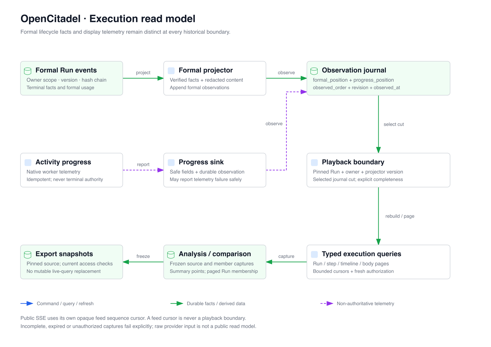

# Event-Sourced Execution Kernel

[简体中文](execution-kernel.zh-CN.md)

OpenCitadel has one execution runtime for Agent, Ask, knowledge ingestion,
automation, patrol, remediation, and evaluation subject/Judge Runs. PostgreSQL execution
events are the only lifecycle authority. Product tables store content and query
projections; Redis is only a disposable wake-up transport.

## Runtime topology

The diagram separates lifecycle facts, off-stream progress, and query views.
Evaluation orchestrators submit commands through the same admission boundary;
they do not introduce another execution engine.

The API validates identity and owner scope, persists a command, and returns or
streams projections. It never executes workflow steps. The execution-kernel
process claims database work, calls registered Activity handlers, and reports
outcomes through new commands. A lost Redis notification is recovered by
polling pending PostgreSQL rows.

## Authoritative records

- `execution_events` is the append-only fact log. Every stream has an owner
  scope, monotonically increasing version, and verified hash chain.
- `execution_command_inbox` makes command submission idempotent and records a
  stable accepted or rejected result.
- `execution_activity_tasks` persists request generation, claim fencing,
  call-start, heartbeat, outcome, and unknown-outcome state.
- `execution_scheduled_commands` persists timers and cancellation.
- `execution_outbox` persists post-commit wake-ups. Delivery may repeat without
  changing business semantics.
- snapshots accelerate replay; each snapshot is integrity-checked and an
  invalid snapshot falls back to verified event replay.

`execution_run_projection`, `execution_resource_build_projection`, approval
and activity projections, and `execution_public_events` are rebuildable. They
may lag but cannot create facts or decide terminal state.

## Lease, tool intent and external effect recovery

Worker slots are reserved before claiming. Claims and heartbeats carry the
database clock, absolute lease deadline and claim generation; renewal never
extends the Activity's business deadline. Supervision covers the handler,
content write and settlement. A lost claim cannot publish formal content or
settle its result, even if an old handler later returns.

Tool recovery uses each Invocation's frozen `RecordedContract` and exact
`ToolApprovalSubject`, including arguments, target, scope and authorization
epoch. Selected schema, binding or permission drift stops before sending.
`ActivityFailed` v3 retains explicit no-send drift evidence; earlier event
versions upcast without rewriting stored hashes. Refreshing the intent creates
a new Invocation and approval in the same Run. The old approval is not reusable.

External effect facts remain in Run events. The operation/receipt indexes are
rebuildable; verification requests are durable work. An uncertain write waits
for an original-key provider query or evidence-backed human resolution.
`applied` without a complete result waits for material, while `not_applied`
settles the original Invocation without resending it. Late facts after Run
cancellation do not revive it. Business recovery does not clear physical usage
or budget holds. [Deployment recovery guidance](../operations/deployment.md)
describes the metrics and operator actions.

Queued human verification rechecks the actor before reading or copying evidence
and again when committing the result. Reclaimed queries consume the original
operation's query budget, including attempts whose responses were lost.
Contradictory outcomes or business results quarantine the live Run. Later receipts
remain evidence but cannot resume it or overwrite the original result; cancellation
remains available and accounting holds retain their independent authority.

KB and memory vectors carry an `EmbeddingSpaceDescriptor`; equal dimensions
or model IDs do not establish compatible spaces. Access and the frozen space
are rechecked before cache reuse. Providers without a verifiable immutable
revision cannot satisfy strict revision policy.

## Horizontal scale and single-writer projection

Multiple execution-kernel replicas run safely against the same database:

- **Inbox `SKIP LOCKED`.** Command-inbox claiming uses `FOR UPDATE SKIP LOCKED`,
  so replicas claim disjoint rows instead of contending on the same batch.
- **Safe-watermark projection.** Projectors only advance over positions below a
  stable snapshot watermark (`pg_snapshot_xmin`), so an event committed out of
  order behind an in-flight transaction is never skipped. A per-owner-scope
  `execution_scope_head` table records each scope's head position; pending-scope
  discovery degrades to a `head > checkpoint` index lookup instead of scanning.
- **Single-writer product state.** Execution-authoritative columns on product
  tables (session/patrol status, `active_execution_run_id`, and similar) are
  written only by the projector. Application services read the projection. Every
  such projected row carries a `last_event_position` column and the projector's
  `UPDATE` is guarded by `WHERE last_event_position IS NULL OR < :position`, so a
  slow or duplicated projection can never overwrite newer state.
- **Poison isolation.** A decision row that cannot be processed is quarantined
  by `run_id` in `execution_poisoned_runs` and counted
  (`execution_poisoned_runs_total`) rather than aborting the whole batch.
  Owner-scoped authorization revocation is handled locally. Unexpected failures
  in critical runtime lanes still withdraw readiness and request shutdown; poison
  isolation does not suppress durable-store or control-plane failures.

## Run and Activity protocol

Every production behavior is a `Run` in one of six families: `agent`, `ask`,
`kb_ingest`, `automation`, `patrol`, or `remediation`.

Evaluation subjects reuse the configured `agent` or `ask` family; a restricted
Judge is an `ask` child Run with source type `evaluation_judge`. Batch, score, and
review state belong to the [evaluation control plane](evaluation-control-plane.md),
not to additional Run families.

A Run accepts typed commands and produces typed events through a pure decision
handler. Only one terminal event can be accepted.

All nondeterministic work is an Activity. The request and invocation identity
are committed before an external call. A repeated delivery for the same
invocation reuses its persisted result; a new invocation executes even when
its arguments match a previous one. Claim generation fences stale workers.
Timeout, retry, approval, cancellation, and unknown outcome are explicit
states, never inferred from process death or transport metadata.

External writes require a persisted policy snapshot and formal approval before
call-start. Approval decisions use dedicated command endpoints and projections;
chat text cannot bypass the gate.

## Resource candidates

Knowledge rebuilds have one artifact authority: their immutable candidate
version. The candidate carries `build_id`, request idempotency key,
state, capability result, metrics, and publication timestamp. Build lifecycle
and progress come exclusively from the source Run projection.

At most one `building` candidate exists per resource. Publication validates the
complete candidate closure and compare-and-swaps `active_version_id`. Failures
and cancellation mark only the candidate; the active published version remains
readable. Session resource bindings pin a concrete published version.

## Public events and recovery

Live delivery and replay use sanitized database projections. Formal events
carry their original event position. Activity progress is an off-stream telemetry
source and is not a lifecycle fact; it cannot complete, fail, or cancel a Run.
Private Activity inputs and provider payloads never enter the public projection.

## Execution visualization read model

The formal projector and `PostgresActivityProgressSink` feed the per-Run
`execution_view_observations` journal. Each observation records its source
identity and source kind (`formal` or `progress`); insertion, deduplication,
ordering, and view updates share one transaction and per-Run serialization.
Formal source replay reuses its original observation cut. Progress telemetry
failure is nonfatal to the executing Activity, so a view must expose missing
coverage instead of assuming a complete history.

The typed query service reconstructs Run, step, timeline, approval, artifact, and
message views at one `PlaybackBoundary`. That boundary binds `run_id`,
`formal_position`, `progress_position`, `observed_order`, projection revision,
projector version, and observation time. Signed cursors also bind OwnerScope and
the query digest. An event position alone is therefore insufficient to identify
an execution-view cut. List/cohort captures, shadow generations, and read caches
accelerate bounded queries; they do not create execution facts. An unavailable
or expired cut is reported explicitly, and partial history retains completeness
and missing-interval metadata.

Analysis, comparisons, and exports consume captured sources and pins over these
read models. Their metrics and saved views do not override formal Run state;
current access checks and redaction still apply to retained query artifacts.

Recovery always starts from PostgreSQL: verify the event chain, load a valid
snapshot when available, replay later events, and reclaim expired database
work. Redis loss, process restart, and duplicate delivery are expected
conditions. If integrity or owner scope validation fails, execution stops
closed and emits operational evidence.

## Versioned long-running execution

Admission fixes an immutable definition pin in the accepted Run. The pin names
the planner, Activity handlers, context compiler and supported schemas; changing
the published head affects future admissions only. Workers publish expiring
capabilities and filter work before claiming it. Missing compatible workers
produce a derived version-unavailable diagnostic, without changing the Run's
lifecycle or retry count. Retirement checks include pending approvals and
unresolved external effects, including obligations on cancelled Runs.

Command recovery and ordinary physical dispatch share a verified Run loader.
It validates snapshot identity, serializer, definition pin and formal anchor,
then verifies and folds the event tail. A bad snapshot can be discarded; a bad
formal event chain cannot. Stored event hashes are verified before schema
upcasting. Snapshot state still has a loading cost even when the event tail is
small.

Agent and Ask context comes from accepted private inputs and formal results at
a fixed source boundary. Durable `context.prepare` builds a deterministic,
bounded manifest against every frozen model candidate. `context.compact` uses
independently admitted and settled summary calls, with persisted proposals and
receipts for recovery. Model and summary dispatch check the native wire payload
against that evidence, including provider fallback. Summaries do not become
system instructions, executable tool calls, original evidence or authority to
send requests.

Session checkpoints publish with compare-and-swap after their complete source
collection is available. Original evidence retains bounded indexes for exact
reads; current scope and source permissions are checked again on reads and
physical sends. Agent may request original spans through its read tool, while
Ask uses the kernel's original lookup without gaining execution tools. A
revoked or missing source makes dependent content unavailable. The version-2
Agent definition permits the configured number of tool rounds followed by one
tools-disabled final answer; that answer still has its own prepare and budget
admission.

Private object writes register durable ownership before uploading bytes, using
an independent bounded pool. Publication and collection share the scope append
lock. The collector keeps active work, approvals, unresolved effects, retained
Sessions including the recycle bin, parent/child dependencies, recordings, pins
and evaluation evidence. It keeps unverifiable dependency closures rather than
deleting them. Eligible collections receive an irreversible tombstone before
external deletion; bounded retries and later sweeps also remove late uploads.
The collector does not delete formal events. Retention defaults and the
development database rebuild requirement are documented in `api/README.md`.

## Runtime ownership and shutdown

`app.composition.kernel` constructs one immutable `KernelRuntime`; it never
shares the API's resources. Its `TaskSupervisor` owns the execution loop,
heartbeat, scheduler, policy listener, sandbox pool, and maintenance loops. It
also owns four critical evaluation lanes: scheduling, reconciliation, scoring,
and cleanup.
Critical-task failure requests process shutdown, while an auxiliary listener
may restart under its declared bounded policy.

The health marker is written atomically by the owned heartbeat and removed in
its `finally` block. Readiness requires that marker, a ready Runtime Policy,
the execution schema, and the dedicated database role; liveness checks only
the process identity and marker freshness. On SIGTERM the supervisor first
revokes readiness, then cancels and waits for owned tasks within
`OPENCITADEL_SHUTDOWN_TIMEOUT_SECONDS`.

Every execution mutation follows the same transaction rule as the API:
repositories flush but never commit, application code calls `uow.commit()`,
and an uncommitted context exit rolls back. Outbox delivery and Redis wake-ups
are post-commit effects.

## Process and privilege boundaries

- API role: submit commands and read owner-scoped projections.
- Execution role: append events, claim Activities/timers/outbox, and update
  formal projections.
- Migration role: schema ownership and DDL only.
- PostgreSQL bootstrap role: provisions the narrower roles; applications do not
  own execution tables.

Row-level security is enabled and forced on every owner-scoped execution table.
The store rejects an append whose context differs from the existing stream
scope even when the caller has system authorization.

## Implementation anchors

- Runtime ownership: `api/app/composition/kernel.py`,
  `api/app/composition/kernel_runtime.py`.
- Formal authority and projections: `api/app/infrastructure/execution/postgres_event_store.py`,
  `api/app/infrastructure/execution/postgres_formal_projector.py`.
- Progress and observation journal: `api/app/infrastructure/execution/postgres_progress_sink.py`,
  `api/app/infrastructure/execution/postgres_view_observations.py`.
- Bounded views and cursors: `api/app/application/services/execution_view_service.py`,
  `api/app/application/execution/view_cursor.py`,
  `api/app/infrastructure/execution/postgres_execution_view.py`.
- Definition lifecycle and verified recovery:
  `api/app/infrastructure/execution/postgres_definition_store.py`,
  `api/app/infrastructure/execution/verified_run_loader.py`.
- Context preparation and checkpoints:
  `api/app/infrastructure/execution/context_preparation.py`,
  `api/app/infrastructure/execution/context_wire_payload.py`,
  `api/app/infrastructure/execution/postgres_context_checkpoint.py`.
- Private object retention:
  `api/app/infrastructure/execution/execution_object_lifecycle.py`,
  `api/app/infrastructure/execution/execution_object_roots.py`.
