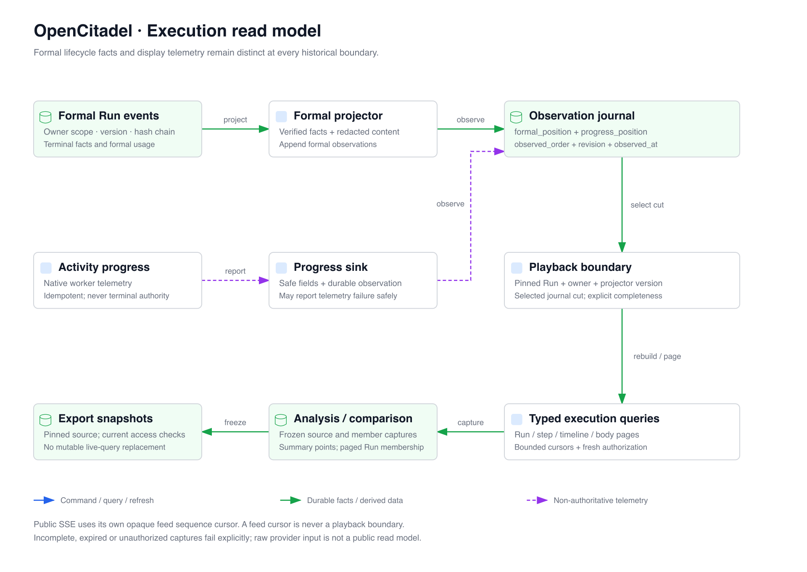

# 事件溯源执行内核

[English](execution-kernel.md)

OpenCitadel 使用一套执行运行时承载 Agent、Ask、知识库摄取、自动化、
Patrol、Remediation 以及评测 Subject/Judge Run。PostgreSQL 执行事件是唯一生命周期事实来源；产品表只保存
内容与查询投影，Redis 只承担可丢失的唤醒通知。

## 运行拓扑

图中区分生命周期事实、流外进度与查询视图。评测编排器通过同一 Admission 边界提交
Command，不引入第二套执行引擎。

API 只校验身份与 OwnerScope、持久化 Command、返回或流式读取投影，不直接执行工作流。
Execution Kernel 进程认领数据库工作，调用注册的 Activity Handler，再通过新 Command
报告结果。Redis 通知丢失后，由 PostgreSQL 待处理行轮询恢复。

## 权威记录

- `execution_events` 是追加式事实日志；每条 Stream 都有 OwnerScope、单调版本与可验证哈希链。
- `execution_command_inbox` 保证 Command 幂等，并保存稳定的接受或拒绝结果。
- `execution_activity_tasks` 保存请求代次、认领 fencing、call-start、心跳、结果与未知结果状态。
- `execution_scheduled_commands` 保存 Timer 及其取消状态。
- `execution_outbox` 保存提交后的唤醒；允许重复投递，但不得重复产生业务事实。
- Snapshot 只用于加速；读取时校验完整性，失效时回退到已验证的事件重放。

`execution_run_projection`、`execution_resource_build_projection`、审批与 Activity 投影以及
`execution_public_events` 都可重建。它们可以短暂落后，但不能产生事实或决定终态。

## 租约、工具意图与外部效果恢复

Worker 在认领前预留 slot。Claim 与心跳携带数据库时间、绝对租约期限与 claim generation；
续租不延长 Activity 的业务期限。监督器覆盖 handler、内容写入和正式结算；旧 handler 晚返回也不能
越过失效租约发布正式内容或结算结果。

工具恢复按每个 Invocation 的冻结 `RecordedContract` 和精确 `ToolApprovalSubject` 执行，
绑定参数、目标、scope 与授权 epoch。所选 schema、binding 或权限漂移在发送前停止。
`ActivityFailed` v3 保留明确的未发送漂移证据；旧事件 upcast 不改存储哈希。
刷新意图在同一 Run 中创建新的 Invocation 与审批，不能复用旧审批。

外部效果事实仍在 Run 事件中；operation/receipt 表是可重建索引，核验请求是持久化工作。
未知写入等待原 key 的 provider 查询或有证据的人工结算。`applied` 缺完整结果时等待补材料；
`not_applied` 结算原 Invocation，不重发。Run 取消后的晚到事实不复活 Run，
业务恢复不清除物理用量或预算 hold。[部署恢复说明](../operations/deployment.zh-CN.md)
提供指标和操作指引。

排队的人工核验在读取、复制证据之前重新检查操作者权限，提交结果时再次检查。
查询重领仍消耗原 operation 的查询预算，包括响应丢失的尝试。
矛盾结论或业务结果会隔离仍在运行的 Run；后续回执仅保留为证据，不能恢复执行或覆盖原结果。
操作者仍可取消 Run，计费 hold 的结算权威保持独立。

KB 与 memory 向量保存 `EmbeddingSpaceDescriptor`；维度或 model ID 相同不能证明空间兼容。
缓存复用前重新校验访问权限与冻结空间。Provider 无法证明不可变 revision 时，不能满足严格 revision 策略。

## 水平扩展与单一写者投影

多个执行内核副本可安全地对同一数据库运行：

- **Inbox `SKIP LOCKED`。** Command Inbox 认领使用 `FOR UPDATE SKIP LOCKED`，副本认领互不
  相交的行，而非争抢同一批。
- **安全水位投影。** 投影器只推进到稳定快照水位（`pg_snapshot_xmin`）以下的 Position，因此
  在途事务后乱序提交的事件绝不会被跳过。按 Owner Scope 的 `execution_scope_head` 表记录各
  Scope 的 Head Position；待处理 Scope 发现退化为 `head > checkpoint` 索引查询而非扫描。
- **产品状态单一写者。** 产品表上的执行权威列（Session/Patrol 状态、
  `active_execution_run_id` 等）只由投影器写入，应用服务读投影。每个此类投影行带
  `last_event_position` 列，投影器的 `UPDATE` 由 `WHERE last_event_position IS NULL OR <
:position` 守卫，慢或重复的投影绝不会覆盖更新的状态。
- **毒行隔离。** 无法处理的 Decision 行按 `run_id` 隔离到 `execution_poisoned_runs` 并计数
  （`execution_poisoned_runs_total`），而不作废整批；OwnerScope 授权撤销在对应 Scope
  内处理。关键运行任务的非预期失败仍会撤销就绪状态并请求关闭进程；毒行隔离不会吞掉
  持久化存储或控制面的故障。

## Run 与 Activity 协议

所有生产行为都属于六类 Run：`agent`、`ask`、`kb_ingest`、
`automation`、`patrol`、`remediation`。Run 通过纯 Decision Handler 接受类型化 Command、
产生类型化 Event，并且只能接受一个终态事件。

评测 Subject 复用配置指定的 `agent` 或 `ask` Family；受限 Judge 是 Source Type 为
`evaluation_judge` 的 `ask` 子 Run。Batch、评分与人工复核状态属于
[评测控制面](evaluation-control-plane.zh-CN.md)，不增加 Run Family。

所有非确定性工作都建模为 Activity。外部调用前先提交请求与 Invocation 身份；同一
Invocation 的重复投递复用持久化结果，新 Invocation 即使参数相同也必须重新执行。
Claim generation 隔离过期 Worker。超时、重试、审批、取消和未知结果都是显式状态，
不能从进程死亡或传输元数据推断。

外部写操作必须在 call-start 前持久化策略快照并获得正式审批。审批通过专用 Command
端点和投影处理，聊天文本不能绕过门控。

## 资源候选版本

知识库重建只有一个制品状态来源：不可变候选版本。候选版本保存 `build_id`、
请求幂等键、制品状态、能力结果、指标与发布时间；构建生命周期和进度只来自源 Run 投影。

每个资源最多存在一个 `building` 候选。发布前验证完整闭包，并对 `active_version_id`
执行 CAS。失败或取消只标记候选版本，不影响当前已发布版本。Session Resource Binding
固定到一个具体的已发布版本。

## 公开事件与恢复

实时流与 Replay 读取脱敏数据库投影。正式事件保留其原始 Event Position。
Activity Progress 是流外遥测，不是生命周期事实，不能完成、失败或取消 Run。
Activity 私有输入和 Provider 原始载荷不得进入公开投影。

## 执行可视化读模型

Formal Projector 与 `PostgresActivityProgressSink` 共同写入按 Run 组织的
`execution_view_observations` Journal。每条 Observation 保存来源身份及来源类别
（`formal` 或 `progress`）；插入、去重、排序与视图更新在同一事务内完成，并按 Run
串行化。正式来源重放复用原有 Observation Cut。进度遥测写入失败不会导致 Activity
失败，因此视图必须披露缺失覆盖范围，不能把遥测当成完整历史。

类型化查询服务在同一 `PlaybackBoundary` 下重建 Run、Step、Timeline、Approval、
Artifact 和 Message 视图。Boundary 固定 `run_id`、`formal_position`、
`progress_position`、`observed_order`、Projection Revision、Projector Version 与
Observation 时间。签名 Cursor 还绑定 OwnerScope 与 Query Digest，因此只保存 Event
Position 无法标识执行视图切面。列表/Cohort Capture、Shadow Generation 和 Read Cache
加速有界查询，不产生执行事实。切面不可用或已过期时明确返回错误；历史不完整时保留
Completeness 与 Missing Interval 元数据。

分析、对比与导出消费这些读模型上的 Capture 和 Pin。指标及保存视图不能覆盖正式 Run
状态；保留的查询产物仍受当前访问权限与脱敏规则约束。

恢复始终从 PostgreSQL 开始：校验事件链、读取有效 Snapshot、重放后续事件、重新认领
过期数据库工作。Redis 丢失、进程重启和重复投递都属于正常故障模型。完整性或 OwnerScope
校验失败时必须 fail-closed，并产生运维证据。

## 版本固定与长任务执行

准入在已接受 Run 中固定不可变 Definition Pin，明确 Planner、Activity Handler、
Context Compiler 与支持的 Schema。切换发布 Head 只影响后续准入。Worker 发布带过期时间
的能力，并在领取前过滤工作。缺少兼容 Worker 时派生版本不可用提示，不改变 Run 生命周期
或重试次数。退休检查涵盖待批准事项和未结算外部操作，包括已取消 Run 上仍存在的义务。

Command 恢复与普通物理发送共用可信 Run Loader：验证 Snapshot 身份、Serializer、
Definition Pin 及正式 Anchor，再验证和折叠 Event Tail。坏 Snapshot 可以丢弃，坏正式事件链
不能降级。事件先按存储原貌验证 Hash，再做 Schema Upcast。即使 Tail 很小，加载 Snapshot
State 仍有成本。

Agent 与 Ask 的上下文来自固定来源边界内已接受的私有输入和正式结果。持久化
`context.prepare` 针对所有冻结模型候选确定性生成有界 Manifest；`context.compact`
使用独立准入和结算的摘要调用，并持久化 Proposal 与回执以支持恢复。主模型与摘要发送
均复验原生 Wire Payload 与准备证据是否一致，包括 Provider Fallback。摘要不会变成
System 指令、可执行工具调用、原始证据或发送授权。

Session Checkpoint 在完整来源集合可用后通过 CAS 发布。原文保留有界索引以支持精确读取；
每次读取和物理发送再次检查当前 Scope 与来源权限。Agent 可通过只读工具请求原文片段，
Ask 使用内核原文检索，不因此获得执行工具。来源撤权或缺失会使派生内容不可用。v2 Agent
定义允许配置数量的工具轮次，再执行一次禁用工具的收尾回答；收尾仍有独立 Prepare 与
预算准入。

私有对象上传前，通过独立有界连接池持久登记所有权。发布与回收共用 Scope Append Lock。
回收保留活跃任务、审批、未决外部操作、保留的 Session（包括回收站）、父子依赖、录制、
Pin 与评测证据；无法验证的依赖闭包继续保留。可回收集合先写不可逆墓碑，再执行外部删除，
通过有界重试与后续重扫处理失败和迟到上传。回收器不删除正式事件。默认保留期限与开发期
重建数据库要求见 `api/README.md`。

## 运行时所有权与关闭

`app.composition.kernel` 构建一个不可变 `KernelRuntime`，不会与 API 共享资源。
`TaskSupervisor` 持有执行循环、Heartbeat、Scheduler、Policy Listener、Sandbox Pool 与
Maintenance Loop，以及调度、对账、评分、清理四条关键评测 Lane。关键任务失败会请求进程关闭；辅助监听器只按声明的有界策略重启。

健康 Marker 由归属明确的 Heartbeat 原子写入，并在其 `finally` 中删除。Readiness 同时要求
Marker、Runtime Policy、执行 Schema 与专用数据库角色就绪；Liveness 只检查进程身份和
Marker 新鲜度。收到 SIGTERM 后，Supervisor 先撤销就绪状态，再在
`OPENCITADEL_SHUTDOWN_TIMEOUT_SECONDS` 内取消并等待全部归属任务。

每个执行 Mutation 与 API 遵守相同事务规则：Repository 只 flush、永不 commit，Application
调用 `uow.commit()`；Context 未提交即退出时 rollback。Outbox 投递与 Redis 唤醒均为
post-commit Effect。

## 进程与权限边界

- API Role：提交 Command、读取 OwnerScope 投影。
- Execution Role：追加事件、认领 Activity/Timer/Outbox、更新正式投影。
- Migration Role：只负责 schema ownership 与 DDL。
- PostgreSQL Bootstrap Role：创建最小权限角色；应用进程不拥有执行表。

所有 OwnerScope 执行表都启用并强制 RLS。即使调用方拥有 system authorization，Event Store
也会拒绝与既有 Stream OwnerScope 不一致的追加。

## 实现锚点

- 运行时归属：`api/app/composition/kernel.py`、
  `api/app/composition/kernel_runtime.py`。
- 正式事实与投影：`api/app/infrastructure/execution/postgres_event_store.py`、
  `api/app/infrastructure/execution/postgres_formal_projector.py`。
- 进度与 Observation Journal：`api/app/infrastructure/execution/postgres_progress_sink.py`、
  `api/app/infrastructure/execution/postgres_view_observations.py`。
- 有界视图与 Cursor：`api/app/application/services/execution_view_service.py`、
  `api/app/application/execution/view_cursor.py`、
  `api/app/infrastructure/execution/postgres_execution_view.py`。
- Definition 生命周期与可信恢复：
  `api/app/infrastructure/execution/postgres_definition_store.py`、
  `api/app/infrastructure/execution/verified_run_loader.py`。
- 上下文准备与 Checkpoint：
  `api/app/infrastructure/execution/context_preparation.py`、
  `api/app/infrastructure/execution/context_wire_payload.py`、
  `api/app/infrastructure/execution/postgres_context_checkpoint.py`。
- 私有对象保留：`api/app/infrastructure/execution/execution_object_lifecycle.py`、
  `api/app/infrastructure/execution/execution_object_roots.py`。
