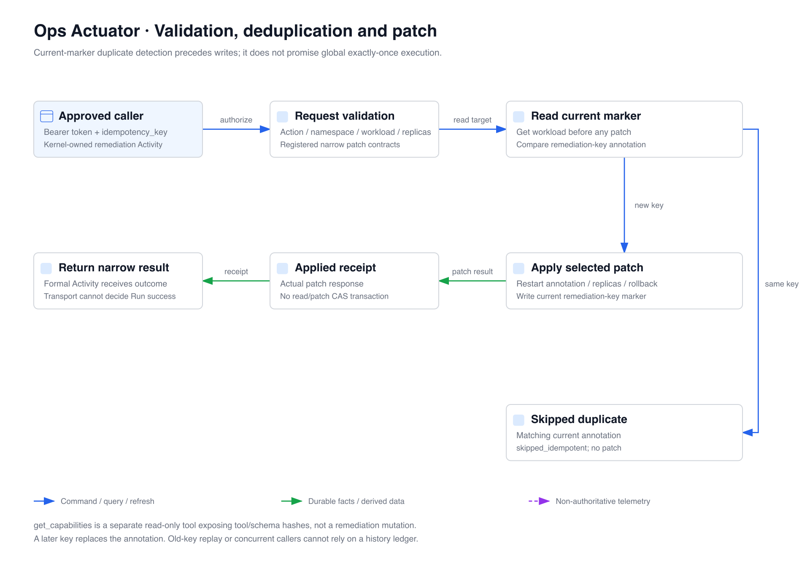

[简体中文](README.zh-CN.md)

# OpenCitadel Ops Actuator

The Ops Actuator is a separately deployable, write-capable MCP service for Ops Patrol remediation. It is the write-side sibling of the read-only [Ops Collector](../ops-collector/README.md) and shares its structure and security posture. It exposes exactly **three registered write actions** — restart, scale, and rollback — against namespace- and workload-allowlisted Kubernetes Deployments/StatefulSets. There is no arbitrary `kubectl`, no free-form command execution, and no access to Secrets, `exec`, or `attach`.

## Operations

| Tool                | Kind support            | Mutates | Bounded input                                                                                                                                      |
| ------------------- | ----------------------- | ------- | -------------------------------------------------------------------------------------------------------------------------------------------------- |
| `get_target` | Deployment / StatefulSet | No | Resolve an allowlisted current UID before approval |
| `get_operation` | — | No workload writes | Authenticated operation ID; retained receipt or conservative recovery |
| `get_capabilities`  | —                       | No      | Returns tool/schema/capability hashes                                                                                                              |
| `restart_workload`  | Deployment, StatefulSet | Yes     | Allowlisted namespace + registered workload id; requires `idempotency_key`                                                                         |
| `scale_workload`    | Deployment, StatefulSet | Yes     | Allowlisted namespace + registered workload id; `replicas` must be within the registered `min_replicas`/`max_replicas`; requires `idempotency_key` |
| `rollback_workload` | Deployment only         | Yes     | Allowlisted namespace + registered workload id; requires `idempotency_key`                                                                         |

`get_capabilities`, `get_target(namespace, workload, kind)` and `get_operation(operation_id)` are read-only business tools. The platform discovers `effect_contract.target_identity`, resolves the current UID through `get_target` before approval, and freezes it with the platform-generated operation ID and digest; model output never supplies these identities. All three writes require `idempotency_key`, `operation_id`, `payload_digest` and the observed `target_uid`. The authenticated static bearer represents the configured `caller_authority`; callers cannot supply a different authority in arguments. Keep the original `rem:{id}` remediation key.

The v2 payload digest is SHA-256 of sorted, compact UTF-8 JSON containing `action`, `target_ref`, `namespace`, `workload`, `kind`, `target_uid` and `parameters` (`{"replicas": N}` for scale, `{}` otherwise). `operation_payload_digest()` in `contracts.py` is the canonical implementation. Reusing a key or operation ID for another payload/target returns `OPERATION_CONFLICT`.

A namespaced ConfigMap journal persists the immutable binding, the first restart timestamp or rollback template, and the original target UID/resourceVersion before sending. The single main-resource patch writes the business change and `opencitadel.io/operation-id` / `opencitadel.io/payload-digest` annotations atomically. Parallel processes use ConfigMap create/CAS and the fixed target preconditions. A conflict queries the original operation; it never rebases onto a newer target version.

`get_operation` returns the retained receipt or checks the original target UID and both annotations to recover it. Missing/overwritten annotations, target recreation, and read failures remain `unknown`; matching current replicas is not proof. Same-key recovery reuses the persisted patch and preconditions. The service performs no automatic second write attempt within a call. A target gate blocks later operations until its predecessor's terminal receipt is durable. Other Kubernetes writers can still remove recovery proof, so this is not a distributed exactly-once guarantee.

`ActuatorEnvelope` version 2 adds `operation_id`, `state` (`pending`, `applied`, `not_applied`, `unknown`), `receipt_revision`, `payload_digest`, `key_digest`, `target` and `receipt`. It retains `before`/`after`, evidence and errors. `action_outcome` adds `pending`/`unknown` to `applied`/`skipped_idempotent`/`failed`. Terminal receipts remain authoritative even after the workload changes or disappears. Querying can repair a journal receipt but never issues a workload patch.

Journals have a 512 KiB total bound with 16 KiB reserved for receipts. Oversized patches and sensitive literals are rejected before sending. Rollback templates containing literal environment values, commands, arguments, or secret-shaped data are conservatively rejected; references to Secrets are supported without reading their values. All terminal receipts and key bindings are retained indefinitely as tombstones; there is no TTL or delete path. Journal permission/storage failure fails closed before new physical writes. Unknown/prepared entries are never automatically removed.

## Request flow



Only the backend execution service — never the model — calls one of the three write actions, and only after a human approves the specific call; see [Governance plane](../docs/architecture/governance-plane.md) for the approval and idempotency-key contract shared by every governed write, and [Ops Patrol architecture](../docs/architecture/ops-patrol.md#safety-invariants) for this service's own safety invariants.

## Configuration reference

Configuration is environment-only and uses the `OPS_ACTUATOR_` prefix. Structured values are JSON.

| Variable             | Default / range                          | Purpose                                                                                                                                         |
| -------------------- | ---------------------------------------- | ----------------------------------------------------------------------------------------------------------------------------------------------- |
| `TARGET_REF`         | `opencitadel-local`                      | Stable identity matched by the Pack                                                                                                             |
| `JOURNAL_NAMESPACE` | `opencitadel` (Pod namespace in shipped manifests) | ConfigMap journals and target gates |
| `PROVIDER_NAMESPACE` | `opencitadel-ops-actuator` | Stable provider identity; do not change for existing operations |
| `CALLER_AUTHORITY` | `opencitadel-platform` | Stable principal represented by the configured bearer token |
| `ALLOWED_NAMESPACES` | `["opencitadel"]`                        | Non-empty namespace allowlist                                                                                                                   |
| `ALLOWED_WORKLOADS`  | `{}`                                     | JSON map of namespace to workload id to `{kind, min_replicas, max_replicas}`; a workload not listed here cannot be targeted by any write action |
| `TOKEN`              | No valid default; at least 32 characters | Required for streamable HTTP; every request needs `Authorization: Bearer <token>`                                                               |
| `TRANSPORT`          | `streamable-http`                        | `streamable-http` or development-only `stdio`                                                                                                   |
| `ALLOW_STDIO`        | `false`                                  | Must also be true before stdio can start                                                                                                        |
| `HOST` / `PORT`      | `0.0.0.0` / `8091`                       | Listener for streamable HTTP (`/mcp`)                                                                                                           |
| `CONCURRENCY`        | `4`, range 1–8                           | Maximum simultaneous write actions                                                                                                              |
| `MAX_OUTPUT_BYTES`   | `65536`, max 1 MiB                       | Serialized response cap                                                                                                                         |
| `MAX_ROWS`           | `200`, max 1000                          | Tabular/sample cap                                                                                                                              |
| `MAX_ARRAY_ITEMS`    | `200`, max 1000                          | Per-array cap                                                                                                                                   |
| `MAX_STRING_CHARS`   | `32768`, max 131072                      | Per-string cap                                                                                                                                  |

The complete variable name is the prefix plus the table name, for example `OPS_ACTUATOR_ALLOWED_WORKLOADS`.

Example Helm values use native YAML objects and render them to JSON:

```yaml
opsActuator:
  enabled: true
  targetRef: production-cluster-a
  allowedNamespaces: [opencitadel]
  allowedWorkloads:
    opencitadel:
      opencitadel-api:
        kind: deployment
        min_replicas: 2
        max_replicas: 10
      opencitadel-execution-kernel:
        kind: deployment
        min_replicas: 1
        max_replicas: 6
```

Only workloads listed under `allowedWorkloads` can ever be restarted, scaled, or rolled back; every other request is denied (`NAMESPACE_DENIED` / `TARGET_DENIED`) before any Kubernetes call is made.

## Run locally

Streamable HTTP (`/mcp`, port `8091`) is the default:

```bash
docker compose --profile actuator up -d --build opencitadel-ops-actuator
```

For a fresh Compose installation, `make configure` generates and saves a distinct strong `OPS_ACTUATOR_TOKEN` in `.env`; existing installations keep their token. The shipped Compose service does not pass `OPS_ACTUATOR_ALLOWED_WORKLOADS` or mount kubeconfig, and its default workload allowlist is empty; it supports transport/authentication checks without cluster writes. Use configured Helm/Kustomize allowlists and a dedicated ServiceAccount for real remediation.

For development-only stdio:

```bash
OPS_ACTUATOR_ALLOW_STDIO=true uv run opencitadel-ops-actuator --transport stdio
```

Never enable stdio in the production deployment. Outside a cluster, an explicit `PATROL_DEMO_CONTEXT` is required; the writer never falls back to the current kubectl context.

## Kubernetes deployment

- Helm: set `opsActuator.enabled=true` and configure `allowedNamespaces`/`allowedWorkloads` in `deploy/helm/opencitadel/values.yaml`.
- Kustomize: use `deploy/kustomize/ops-actuator` as a base and patch its image, target ref, and allowlists.
- Keep the Service `ClusterIP`; only the approval/remediation caller should reach port 8091.
- A Role in each allowed namespace grants `get/list/watch/patch` on Deployments/StatefulSets and only `get/list` on ReplicaSets for rollback history. It excludes Secrets, exec, attach, and workload create/delete. A separate Role in the Actuator management namespace permits only ConfigMap get/create/update for journals; no delete permission is granted. RBAC scopes namespaces; the server enforces the exact workload allowlist.
- Review NetworkPolicy egress against the exact Kubernetes API location. The registered-workload allowlist is the application-layer boundary; NetworkPolicy is defense in depth.

The container runs as UID/GID 10001 with a read-only root filesystem, all Linux capabilities dropped, `RuntimeDefault` seccomp, and only a bounded writable `/tmp` — the same posture as the Ops Collector.

The HTTP process refuses to start if the token is missing or shorter than 32 characters. Helm generates and persists the token when enabled; `opsActuator.token` remains an explicit override; the Kustomize base Secret is empty and must be provisioned before apply. Configure `Authorization: Bearer <token>` in encrypted integration headers. TCP health probes verify only listener reachability, not Kubernetes/registered-target readiness or authenticated calls. Kubernetes manifests set `RuntimeDefault` seccomp; Compose sets non-root, read-only root, dropped capabilities, and `no-new-privileges`.

## Authentication and data handling

Kubernetes access uses the Pod ServiceAccount; that credential never becomes a tool argument or response field. The Actuator rejects sensitive fixed patches before persistence and exposes only whitelisted workload observations, bounded identity fields and receipts. Raw Kubernetes exception bodies are never returned. Response limits never silently truncate receipt identities or digests. Do not rely on redaction as the only control: keep the allowlist minimal and never expose the Actuator publicly.

## Development and verification

```bash
cd ops-actuator
uv sync --frozen
uv run pytest -q
```

`tests/test_rbac_baseline.py` requires the shipped Kustomize and fixture RBAC manifests and checks Kubernetes API egress on 443/6443; missing manifests fail.

The real recovery suite requires an explicit disposable `kind-opencitadel-patrol-*` context and its own `KUBECONFIG`. It starts separate HTTP MCP processes with a namespace-scoped ServiceAccount, forwards requests to the actual Kubernetes API, and kills a process after a successful PATCH while withholding its response. It checks concurrent calls, conflicting keys, retained A/B/A receipts, missing recovery proof, and journal permission loss.

```bash
ACTUATOR_K8S_INTEGRATION=1 \
ACTUATOR_EVIDENCE_DIR=/absolute/path/to/evidence \
uv run pytest -q tests/integration/test_operation_recovery.py
```

Set `PATROL_DEMO_CONTEXT` and `KUBECONFIG` before this command. Evidence includes actual PATCH requests and API audit IDs, persisted ConfigMap journals, and MCP receipts; temporary credentials are excluded. The suite deletes its namespaces. `PATROL_RUN_REMEDIATION_FIXTURE=true ./scripts/run-patrol-fixtures.sh` also includes these tests and owns cluster creation and cleanup.

## Related documentation

- [Ops Patrol architecture](../docs/architecture/ops-patrol.md)
- [Ops Patrol operations](../docs/operations/ops-patrol.md)
- [Run a Patrol](../docs/tutorials/06-ops-patrol.md)
- [Ops Collector](../ops-collector/README.md) — the read-only sibling service
