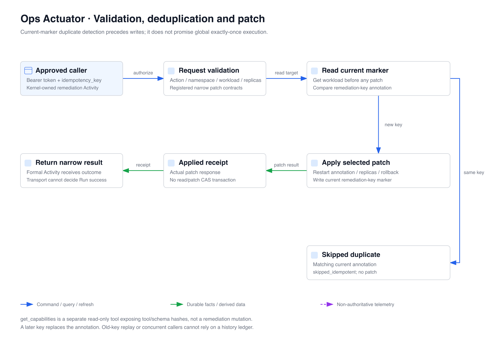

[English](README.md)

# OpenCitadel Ops Actuator

Ops Actuator 是为 Ops Patrol 补救场景独立部署、具备写能力的 MCP 服务，是只读姊妹服务 [Ops Collector](../ops-collector/README.zh-CN.md) 的写操作版本，结构与安全姿态与其保持一致。它仅暴露**三个注册制写动作**——restart、scale、rollback，作用范围限定在 Namespace 与 Workload 均白名单化的 Kubernetes Deployment/StatefulSet 上。不存在任意 `kubectl`、不接受自由格式命令执行，也不访问 Secret、`exec`、`attach`。

## 操作

| Tool                | 支持的 Kind              | 是否变更集群 | 有界输入                                                                                                                        |
| ------------------- | ------------------------ | ------------ | ------------------------------------------------------------------------------------------------------------------------------- |
| `get_target`        | Deployment / StatefulSet | 无           | 审批前解析白名单目标的真实 UID                                                                                                  |
| `get_operation`     | —                        | 否           | 当前认证身份绑定的 operation ID；读取或核验原操作                                                                               |
| `get_capabilities`  | —                        | 否           | 返回 Tool/Schema/Capability Hash                                                                                                |
| `restart_workload`  | Deployment、StatefulSet  | 是           | 白名单 Namespace + 已注册 Workload ID；必须提供 `idempotency_key`                                                               |
| `scale_workload`    | Deployment、StatefulSet  | 是           | 白名单 Namespace + 已注册 Workload ID；`replicas` 必须落在注册的 `min_replicas`/`max_replicas` 之内；必须提供 `idempotency_key` |
| `rollback_workload` | 仅 Deployment            | 是           | 白名单 Namespace + 已注册 Workload ID；必须提供 `idempotency_key`                                                               |

`get_capabilities`、`get_target(namespace, workload, kind)` 与 `get_operation(operation_id)` 是业务只读工具。平台从 `effect_contract.target_identity` 发现目标身份，在审批前通过 `get_target` 读取当前 UID，并与平台生成的 operation ID、digest 一起冻结；这些身份不由模型提供。三个写工具都必须携带 `idempotency_key`、`operation_id`、`payload_digest` 和已观察到的 `target_uid`；继续保留原 `rem:{id}` key。静态 Bearer 凭据对应配置的 `caller_authority`，调用参数不能伪造身份。

v2 payload digest 是规范 JSON（UTF-8、键排序、紧凑分隔符）的 SHA-256，字段为 `action`、`target_ref`、`namespace`、`workload`、`kind`、`target_uid`、`parameters`。scale 的 parameters 为 `{"replicas": N}`，其他为空对象。`contracts.py` 的 `operation_payload_digest()` 为规范实现。相同 key 或 operation ID 绑定不同参数/目标时返回 `OPERATION_CONFLICT`。

管理 namespace 内的 ConfigMap journal 在发送前保存不可变绑定、首次 restart 时间或 rollback 模板、原目标 UID/resourceVersion。主资源的一次条件 patch 同时写业务变化、`opencitadel.io/operation-id` 和 `opencitadel.io/payload-digest`。跨进程使用 ConfigMap create/CAS 与固定目标前置条件；冲突只能核验原操作，不能读取新版本后重算 patch。

`get_operation` 优先返回持久 receipt；无 receipt 时只按原 UID 和两个 annotation 核验。标记被覆盖、目标重建或读取失败保持 unknown，当前副本数相等不能证明成功。同 key 恢复复用固定 patch 和原前置条件；一次调用内没有自动第二次写尝试。前一操作 receipt 持久化后，同目标 gate 才允许后续操作推进。其他 Kubernetes 写入者仍可能破坏恢复证据，因此不承诺跨系统 exactly-once。

`ActuatorEnvelope` v2 新增 operation_id、state（pending/applied/not_applied/unknown）、receipt_revision、payload_digest、key_digest、target、receipt；保留 before/after、evidence、错误字段。action_outcome 在原三个值上新增 pending/unknown。目标之后改变或删除不影响已保存的 receipt。查询允许补全 journal receipt，但绝不发起 workload patch。

journal 总量上限 512 KiB，准备时预留 16 KiB receipt 空间。超限或含敏感字面量的 patch 在发送前拒绝；rollback 模板中的 literal env value、command、args 和秘密形态内容会被保守拒绝，Secret 引用可保留但不读取值。终态 receipt 和 key 绑定永久保留，兼作 tombstone，没有 TTL/delete 路径。journal 存储或权限不可用时禁止新物理写；prepared/unknown 不自动回收。

## 请求流程



只有后端执行服务——绝非模型本身——会调用三个写动作之一，且必须在人工批准该具体调用之后；每次受治理写操作共享的审批与幂等键契约见 [治理平面](../docs/architecture/governance-plane.zh-CN.md)，本服务自身的安全不变量见 [Ops Patrol 架构](../docs/architecture/ops-patrol.zh-CN.md#safety-invariants)。

## 配置参考

配置仅来自环境变量，统一使用 `OPS_ACTUATOR_` 前缀；结构化值使用 JSON。

| 变量                 | 默认值 / 范围              | 作用                                                                                                                         |
| -------------------- | -------------------------- | ---------------------------------------------------------------------------------------------------------------------------- |
| `TARGET_REF`         | `opencitadel-local`        | 与 Pack 匹配的稳定目标身份                                                                                                   |
| `ALLOWED_NAMESPACES` | `["opencitadel"]`          | 非空 Namespace 白名单                                                                                                        |
| `ALLOWED_WORKLOADS`  | `{}`                       | Namespace 到 Workload ID 到 `{kind, min_replicas, max_replicas}` 的 JSON Map；未在此登记的 Workload 无法被任何写动作作为目标 |
| `TOKEN`              | 无默认有效值；至少 32 字符 | Streamable HTTP 必填；每个请求必须携带 `Authorization: Bearer <token>`                                                       |
| `TRANSPORT`          | `streamable-http`          | `streamable-http` 或仅开发使用的 `stdio`                                                                                     |
| `ALLOW_STDIO`        | `false`                    | 启动 stdio 前还必须显式设为 true                                                                                             |
| `HOST` / `PORT`      | `0.0.0.0` / `8091`         | Streamable HTTP 监听地址（`/mcp`）                                                                                           |
| `CONCURRENCY`        | `4`，范围 1–8              | 最大并发写动作数                                                                                                             |
| `MAX_OUTPUT_BYTES`   | `65536`，最大 1 MiB        | 序列化响应上限                                                                                                               |
| `MAX_ROWS`           | `200`，最大 1000           | 表格/采样行上限                                                                                                              |
| `MAX_ARRAY_ITEMS`    | `200`，最大 1000           | 单个数组元素上限                                                                                                             |
| `MAX_STRING_CHARS`   | `32768`，最大 131072       | 单个字符串上限                                                                                                               |

完整变量名为前缀加表中名称，例如 `OPS_ACTUATOR_ALLOWED_WORKLOADS`。

Helm Values 使用原生 YAML 对象，并在模板中渲染为 JSON：

```yaml
opsActuator:
  enabled: true
  targetRef: production-cluster-a
  allowedNamespaces: [opencitadel]
  allowedWorkloads:
    opencitadel:
      opencitadel-api:
        kind: deployment
        min_replicas: 2
        max_replicas: 10
      opencitadel-execution-kernel:
        kind: deployment
        min_replicas: 1
        max_replicas: 6
```

只有在 `allowedWorkloads` 中登记的 Workload 才能被 restart、scale 或 rollback；其余任何请求都会在触达 Kubernetes 之前被拒绝（`NAMESPACE_DENIED` / `TARGET_DENIED`）。

## 本地运行

默认使用 Streamable HTTP（`/mcp`，端口 `8091`）：

```bash
docker compose --profile actuator up -d --build opencitadel-ops-actuator
```

新的 Compose 安装通过 `make configure` 自动生成强 `OPS_ACTUATOR_TOKEN` 并保存到 `.env`，已有安装保留原 Token。当前 Compose 服务不传入 `OPS_ACTUATOR_ALLOWED_WORKLOADS`，不挂载 kubeconfig，且默认白名单为空，因此仅用于传输/认证检查，不能执行集群写操作。真实修复请使用配置了白名单和专用 ServiceAccount 的 Helm/Kustomize。

仅开发使用的 stdio：

```bash
OPS_ACTUATOR_ALLOW_STDIO=true uv run opencitadel-ops-actuator --transport stdio
```

生产部署严禁启用 stdio。

## Kubernetes 部署

- Helm：设置 `opsActuator.enabled=true`，并在 `deploy/helm/opencitadel/values.yaml` 中配置 `allowedNamespaces`/`allowedWorkloads`。
- Kustomize：以 `deploy/kustomize/ops-actuator` 为 Base，Patch 镜像、Target Ref 与白名单。
- Service 保持 `ClusterIP`，仅允许审批/补救调用方访问 8091。
- 每个允许 Namespace 内的 Role 仅对 Deployment/StatefulSet 授予 `get/list/watch/patch`，对 ReplicaSet 授予 `get/list`（回滚时读取历史）；没有 Secret、exec、attach 或 workload create/delete 权限；管理 namespace 的独立 journal Role 只允许 ConfigMap get/create/update。RBAC 按 Namespace 授权，精确 Workload 约束由服务端白名单执行。
- 根据 Kubernetes API 的准确位置复核 NetworkPolicy Egress。已注册 Workload 白名单是应用层边界，NetworkPolicy 作为纵深防御。

容器使用 UID/GID 10001、只读根文件系统、删除全部 Linux Capability、`RuntimeDefault` seccomp，并仅提供有界可写 `/tmp`——与 Ops Collector 保持一致的姿态。

HTTP 进程会在 Token 缺失或不足 32 字符时拒绝启动。Helm 首次启用时自动生成并保存 Token，`opsActuator.token` 继续支持显式覆盖；Kustomize Base 的 Secret 为空，应用前必须填充。集成配置中的加密 Headers 应设置 `Authorization: Bearer <token>`。TCP 健康探针只说明监听端口可达，不保证 Kubernetes/注册目标或认证调用成功。`RuntimeDefault` Seccomp 由 Kubernetes 清单设置；Compose 设置非 Root、只读根目录、Capability Drop 和 `no-new-privileges`。

## 认证与数据处理

Kubernetes 访问使用 Pod ServiceAccount，该凭据不会成为 Tool 参数或响应字段。Actuator 在持久化前拒绝敏感 patch，输出只含固定观察字段与有界 receipt，原始 Kubernetes 错误正文不返回。应保持白名单最小化，Actuator 绝不能暴露到公网。

## 开发与验证

```bash
cd ops-actuator
uv sync --frozen
uv run pytest -q
```

`tests/test_rbac_baseline.py` 强制检查已有 Kustomize 与 Fixture RBAC 清单及 Kubernetes API 443/6443 Egress；缺少清单会失败。

真实恢复测试要求显式指定一次性 `kind-opencitadel-patrol-*` context 及其独立 `KUBECONFIG`。测试启动多个 HTTP MCP 进程，使用 namespace 范围的 ServiceAccount 访问真实 Kubernetes API，并在 PATCH 成功、响应尚未送达时杀掉进程。覆盖并发、同 key 不同参数、A/B/A 回执保留、恢复证据丢失及 journal 失权。

```bash
ACTUATOR_K8S_INTEGRATION=1 \
ACTUATOR_EVIDENCE_DIR=/absolute/path/to/evidence \
uv run pytest -q tests/integration/test_operation_recovery.py
```

运行前设置 `PATROL_DEMO_CONTEXT` 与 `KUBECONFIG`。证据包含真实 PATCH 请求及 API audit ID、持久 ConfigMap journal 和 MCP 回执，不含临时凭据。测试删除自行创建的 namespace。仓库根的 `PATROL_RUN_REMEDIATION_FIXTURE=true ./scripts/run-patrol-fixtures.sh` 也包含这组测试，并负责集群创建和清理。

## 相关文档

- [Ops Patrol 架构](../docs/architecture/ops-patrol.zh-CN.md)
- [Ops Patrol 运维](../docs/operations/ops-patrol.zh-CN.md)
- [运行 Patrol](../docs/tutorials/06-ops-patrol.zh-CN.md)
- [Ops Collector](../ops-collector/README.zh-CN.md) —— 只读姊妹服务

### Journal 部署配置

`OPS_ACTUATOR_JOURNAL_NAMESPACE` 默认为 opencitadel，随附部署使用 Pod namespace；`OPS_ACTUATOR_PROVIDER_NAMESPACE` 默认为 opencitadel-ops-actuator；`OPS_ACTUATOR_CALLER_AUTHORITY` 默认为 opencitadel-platform。后两项是持久身份，已有操作恢复期间不能随意修改。管理 namespace 的独立 Role 仅新增 ConfigMap get/create/update，不授予删除或集群管理员权限。集群外必须显式设置 `PATROL_DEMO_CONTEXT`，不会使用当前 kubectl context。响应只公开固定观察字段、身份与有界 receipt，不返回原始 Kubernetes 错误正文。

`get_target(namespace, workload, kind)` 是 `effect_contract.target_identity` 声明的只读身份查询；平台在审批前冻结返回的 UID，并生成 operation ID 和 payload digest，禁止由模型填写这三个身份参数。
