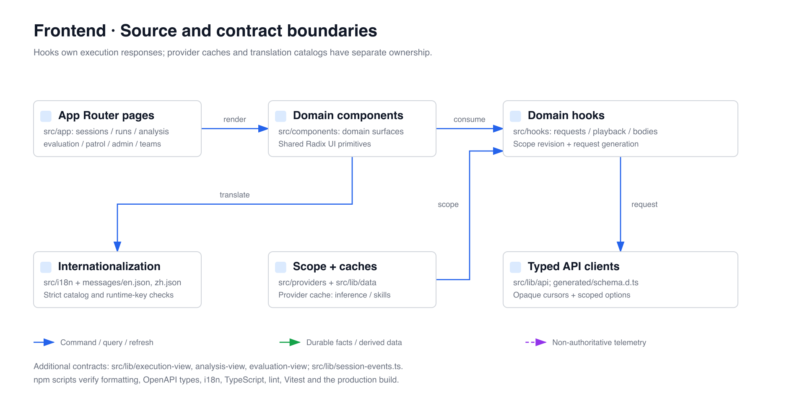

# OpenCitadel UI

[English](README.md)

基于 Next.js 16 / React 19 的前端，覆盖事件溯源 Agent 会话、不可变知识版本、
自动化、巡检、执行工作台、分析/比较/导出、评测、治理与平台管理。

## 契约边界

UI 是投影客户端：提交 API Command，展示正式 Run、Activity、审批、资源构建和公开事件
投影；不会根据连接状态或本地 Timer 推断工作流完成。

- 会话实时流与回放使用同一公开执行事件模型。
- 组件把持久 Cursor 当作不透明值。
- 审批动作针对持久 Approval Batch；聊天文本不是审批协议。
- Activity 私有 Payload、Provider Secret 与事件哈希不进入浏览器契约。
- 资源会话固定绑定一个不可变已发布版本。

## 源码地图



主要路由包括 `/sessions/[id]`、`/knowledge`、`/automation`、
`/patrols`、`/patrol-runs/[id]`、`/teams` 与 `/admin/*`。设置包含通用、Agent、
推理、Skill、记忆、集成，以及仅管理员可见的运行时配置。

知识库创建继承服务端当前 Execution Policy。新安装默认文本提取与关键词检索；运行时
表单仅在对应能力开启时展示增强调参。先在推理中配置可选模型，再启用向量检索、重排、
GraphRAG 或视觉 OCR；已有策略值仍是权威来源。

## 执行与评测入口

- `/runs/[id]`：Live/Playback 工作台与有界正文，历史模式不能直接触发当前动作。
- `/analysis`、`/analysis/comparisons/[id]`：固定源分析、比较 Revision、差异与导出。
- `/evaluations`：Dataset、Configuration、Rubric、Suite、Recording、Environment、Batch、Review 页面。
- Provider 缓存 `inference`/`skills` 资源并提供 Scope；执行、分析和正文响应由各自 Hook 持有。身份/工作区切换使旧 Generation 失效，晚到响应不能跨作用域。
- SSE 触发正式 View 回读；Feed Cursor、分页 Cursor 和历史 `at` 不能互换。Generated OpenAPI 类型位于 `src/lib/api/generated/schema.d.ts`，`npm run api:check` 检查契约同步。

## 开发

```bash
npm ci
npm run format:check
npm run api:check
npm run i18n:check
npm run typecheck
npm run lint
npm run test
npm run build
```

`messages/en.json` 与 `messages/zh.json` 是唯一翻译事实来源。翻译变更直接同步修改
两份词典；`npm run i18n:check` 会拒绝 locale 错配、缺失、未使用、未登记动态调用和
面向用户的硬编码文本。

API 访问统一使用 `src/lib/api/fetch.ts`；保持 TypeScript strict；业务组件放在对应
领域目录；不要在 `src/lib/api/` 之外硬编码 API 路径。

开发服务地址是 `http://localhost:3000`。浏览器 API 默认是相对路径 `/api`；
Next.js Rewrite 把它代理到 `NEXT_PUBLIC_API_PROXY_TARGET`（默认 `http://localhost:8088`）。
`NEXT_PUBLIC_API_BASE_URL` 可显式覆盖浏览器 Base URL；生产流量由 Nginx 统一代理。

只体验完整服务栈可在根目录运行 `make quickstart`，默认访问 `http://localhost:8088`。
独立开发 UI 使用 `http://localhost:3000` 时，将后端 `FRONTEND_BASE_URL` 设为该 Origin，
使邀请链接与 OAuth 回调返回开发 UI。基础配置和高级覆盖分类见
[`deploy/config/.env.reference`](../deploy/config/.env.reference)。

参见[前端架构](../docs/architecture/frontend-ui.zh-CN.md)与
[执行内核](../docs/architecture/execution-kernel.zh-CN.md)。

[执行分析](../docs/architecture/execution-analysis.zh-CN.md) · [评测控制面](../docs/architecture/evaluation-control-plane.zh-CN.md)
